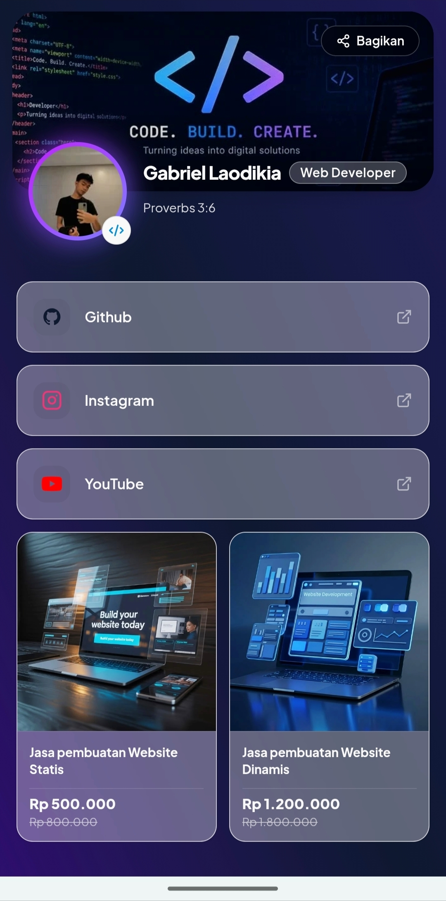
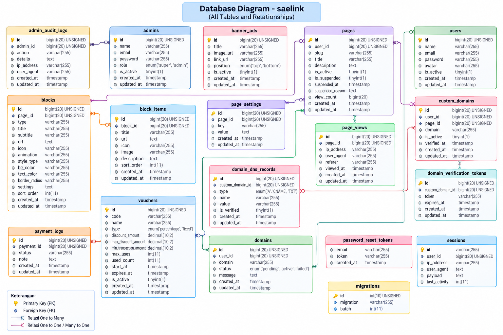

# 🌐 Sae Link — Modern Bio-Link & Microsite Builder Platform

<div align="center">



**Sae Link** adalah platform *all-in-one bio-link & microsite builder* berkecepatan tinggi yang dirancang untuk kreator, profesional, dan UMKM. Memungkinkan pembuatan halaman profil digital yang memukau, responsif, dan interaktif dengan *Live Smartphone Builder*, analitik mendalam, integrasi domain kustom, serta sistem transaksi & voucher.

[](#-frontend-stack)
[](#-frontend-stack)
[](#-backend-stack)
[](#-arsitektur--skema-database)
[](LICENSE)

[Fitur Utama](#-fitur-unggulan) • [Arsitektur Sistem](#-arsitektur-sistem) • [Skema Database](#-arsitektur--skema-database) • [Tech Stack](#-teknologi-yang-digunakan) • [Instalasi](#-panduan-instalasi--menjalankan-proyek) • [Kontak](#-kontributor--penulis)

</div>

---

## 🚀 Fitur Unggulan

### 1. 📱 Live Smartphone Builder (Real-Time Preview)
- **Zero Latency Feedback**: Setiap perubahan teks, warna tema, tipografi, susunan link, dan ikon langsung direfleksikan secara instan ke mockup smartphone tanpa jeda *reload*.
- **Komponen Blok Fleksibel**:
  - Tautan media sosial & URL eksternal dengan ikon modern (GitHub, Instagram, YouTube, LinkedIn, dll.).
  - Kartu katalog produk/jasa digital lengkap dengan harga coret dan badge diskon.
  - Banner promosi & iklan terarah (*top & bottom banner ads*).
  - Tautan WhatsApp otomatis dengan format pesan kustom.
- **Kustomisasi Gaya Visual**: Pengaturan warna latar (*background color* / *gradients*), warna teks, radius sudut (*border radius*), serta animasi mikro (*Apple-like spring easing*).

### 2. 🌐 Custom Domain & Manajemen DNS Terpadu
- Mendukung pemetaan domain kustom pribadi (misal: `link.domainanda.com` atau `profilkreator.id`).
- Sistem verifikasi DNS otomatis mencakup record **CNAME**, **A Record**, dan **TXT Token**.
- Token verifikasi berbasis waktu kedaluwarsa (*time-to-live expiration*) demi keamanan kepemilikan domain.

### 3. 📊 Analitik Pengunjung & Tracking Real-time
- Rekap statistik kunjungan halaman (*page views*) secara real-time.
- Pelacakan sumber trafik (*referrer*), perangkat (*user agent*), dan alamat IP pengunjung.
- Fitur ekspor data log analitik ke format **Excel (.xlsx)** langsung dari peramban.

### 4. 💳 Sistem Transaksi, Voucher, & Banner Iklan
- Integrasi pembayaran digital via **Midtrans Payment Gateway**.
- Manajemen kupon diskon dinamis (**Voucher**) dengan opsi persentase (%) atau nominal tetap (*fixed amount*), batas kuota pemakaian, dan minimal transaksi.
- Manajemen banner iklan bersponsor terkelola.

### 5. 🛡️ Keamanan & Superadmin Panel
- **Role-Based Access Control**: Pemisahan otoritas antara *Superadmin*, *Admin*, dan Pengguna umum.
- **Admin Audit Trail**: Pencatatan log seluruh aktivitas administratif secara presisi (`admin_audit_logs`).
- Proteksi SSRF, Session Hijacking mitigation, CSRF sanitasi, dan otentikasi token via **Laravel Sanctum**.

---

## 🗄️ Arsitektur & Skema Database

Sistem basis data dirancang secara terstruktur dan ternormalisasi menggunakan **MySQL / MariaDB** dengan integritas referensial penuh (ACID Compliance) melalui relasi *Primary Key (PK)* dan *Foreign Key (FK)* pada Eloquent ORM.

### Diagram Relasi Database (ERD)

Berikut adalah diagram lengkap struktur tabel dan relasi antar-entitas dalam platform Sae Link:

<div align="center">



*Gambar: Diagram Relasi Entitas (ERD) Basis Data Sae Link*

</div>

### Ringkasan Entitas & Relasi Tabel Utama

| Kategori | Nama Tabel | Deskripsi & Relasi Utama |
| :--- | :--- | :--- |
| **Pengguna & Akses** | `users` | Entitas akun pengguna, menyimpan profil, email, sandi terenkripsi, dan avatar. |
| | `admins` | Akun staf dan administrator dengan tingkatan peran (*super*, *admin*). |
| | `admin_audit_logs` | Audit trail riwayat tindakan admin (`admin_id` $\rightarrow$ `admins.id`), IP, dan user-agent. |
| **Microsite & Konten**| `pages` | Halaman microsite milik user (`user_id` $\rightarrow$ `users.id`), slug URL, deskripsi, dan status suspensi. |
| | `page_settings` | Konfigurasi fleksibel berbasis *key-value* per halaman (`page_id` $\rightarrow$ `pages.id`). |
| | `blocks` | Elemen penyusun halaman (`page_id` $\rightarrow$ `pages.id`), tipe blok, judul, URL, ikon, warna, dan urutan. |
| | `block_items` | Sub-elemen item dalam satu blok konten (`block_id` $\rightarrow$ `blocks.id`). |
| **Domain Kustom** | `custom_domains` | Pendaftaran domain khusus milik pengguna (`user_id` & `page_id`). |
| | `domain_dns_records`| Rekod DNS (A, CNAME, TXT) untuk validasi routing (`custom_domain_id` $\rightarrow$ `custom_domains.id`). |
| | `domain_verification_tokens` | Token verifikasi kepemilikan domain dengan tanggal kedaluwarsa. |
| | `domains` | Status siklus hidup domain pengguna (*pending*, *active*, *failed*). |
| **Analitik & Trafik** | `page_views` | Catatan metrik kunjungan (`page_id` $\rightarrow$ `pages.id`), referer, alamat IP, dan user-agent. |
| **Monetisasi & Iklan** | `vouchers` | Kode diskon transaksi (tipe *percentage* / *fixed*), kuota penggunaan, dan masa berlaku. |
| | `payment_logs` | Catatan transaksi pembayaran Midtrans (`payment_id`, status, note). |
| | `banner_ads` | Penayangan iklan banner posisi atas (*top*) maupun bawah (*bottom*). |
| **Sistem & Autentikasi**| `sessions` | Sesi aktif pengguna berbasis tabel database untuk keamanan token. |
| | `password_reset_tokens`| Token verifikasi pemulihan kata sandi pengguna. |
| | `migrations` | Riwayat migrasi skema basis data Laravel. |

---

## 🛠️ Teknologi yang Digunakan

Sae Link menerapkan arsitektur **Decoupled / Headless SPA** yang memisahkan lapisan presentasi (*Client-Side Rendering*) dengan lapisan logika bisnis (*Server-Side REST API*).

```
┌────────────────────────────────────────────────────────────────┐
│                        KLIEN / USER                            │
│           (Desktop, Tablet, & Smartphone Android/iOS)          │
└───────────────────────────────┬────────────────────────────────┘
                                │ HTTP / JSON
┌───────────────────────────────▼────────────────────────────────┐
│                     FRONTEND SPA (Vite 6)                      │
│        React 19 • TypeScript • Tailwind CSS v4 • Zustand       │
└───────────────────────────────┬────────────────────────────────┘
                                │ RESTful API (Sanctum Auth)
┌───────────────────────────────▼────────────────────────────────┐
│                     BACKEND API (Laravel 13)                   │
│         PHP 8.3+ • Midtrans SDK • Intervention Image           │
└───────────────────────────────┬────────────────────────────────┘
                                │ Eloquent ORM
┌───────────────────────────────▼────────────────────────────────┐
│                    DATABASE (MySQL / MariaDB)                  │
│               18+ Tabel Relasional • Foreign Keys              │
└────────────────────────────────────────────────────────────────┘
```

### 🎨 Frontend Stack
- **Framework & Runtime**: [React 19](https://react.dev/) + [Vite 6](https://vitejs.dev/)
- **Bahasa Pemrograman**: [TypeScript 5.7+](https://www.typescriptlang.org/)
- **Routing**: [React Router 7](https://reactrouter.com/)
- **Styling**: [Tailwind CSS v4](https://tailwindcss.com/) via `@tailwindcss/vite`
- **State Management**: [Zustand 5](https://zustand-demo.pmnd.rs/) (Mengelola state reaktif builder & preview)
- **Animasi**: [Framer Motion 13](https://www.framer.com/motion/) (Transisi halus & mikro-interaksi)
- **Ikonografi**: [Lucide React](https://lucide.dev/) & [React Icons](https://react-icons.github.io/react-icons/)
- **Form & Validasi**: [React Hook Form](https://react-hook-form.com/) + [Zod](https://zod.dev/)
- **Fitur Tambahan**: [ExcelJS](https://github.com/exceljs/exceljs) (Ekspor analitik), [QRCode](https://github.com/soldair/node-qrcode) (QR Generator instan), [Sonner](https://sonner.emilkowal.ski/) (Toast notifikasi)

### ⚙️ Backend Stack
- **Framework**: [Laravel 13.x](https://laravel.com/) (PHP 8.3+)
- **Autentikasi & Keamanan**: [Laravel Sanctum 4.x](https://laravel.com/docs/sanctum), [Laravel Socialite 5.x](https://laravel.com/docs/socialite) (OAuth Google), Google 2FA (`pragmarx/google2fa`)
- **Pembayaran**: [Midtrans PHP SDK 2.6](https://github.com/Midtrans/midtrans-php-client)
- **Manipulasi Gambar**: [Intervention Image 4.3](https://image.intervention.io/)
- **Basis Data**: [MySQL 8.0+](https://www.mysql.com/) / [MariaDB 10.4+](https://mariadb.org/) dengan Eloquent ORM

---

## 📂 Struktur Direktori Proyek

```
saelink/
├── 📁 backend/                        # REST API Laravel 13, Migrations, Models, & Admin Panel
│   ├── 📁 app/Models/                 # Eloquent Models (User, Page, Block, CustomDomain, dll.)
│   ├── 📁 app/Http/Controllers/       # API Controllers & Admin Dashboard Controllers
│   ├── 📁 database/migrations/        # 18+ Skema Migrasi Database Relasional
│   ├── 📁 routes/api.php              # Definisi Endpoint REST API
│   └── 📄 composer.json
├── 📁 frontend/                       # SPA React 19 + TypeScript + Vite 6
│   ├── 📁 src/components/builder/     # Komponen Live Smartphone Mockup & Block Editors
│   ├── 📁 src/components/dashboard/   # Panel Pengguna, Analitik, & Pengaturan Domain
│   ├── 📁 src/pages/                  # Halaman SPA (Landing, Dashboard, Public Bio-Link)
│   ├── 📁 src/store/                  # Zustand Store (Builder State & User Session)
│   └── 📄 package.json
└── 📁 dokumentasi/                    # Berkas Dokumentasi Teknis & Skema
    ├── 📄 table.png                   # Diagram Relasi ERD Database
    ├── 📄 ss.jpeg                     # Mockup Tampilan Mobile Preview
    ├── 📄 schema.md                   # Kamus Data Skema Lengkap
    └── 📄 tech.md                     # Rasionalisasi Arsitektur & Teknologi
```

---

## 💻 Panduan Instalasi & Menjalankan Proyek

### Prasyarat Sistem
- **PHP** $\ge$ 8.3 dengan ekstensi: `pdo_mysql`, `mbstring`, `fileinfo`, `gd`/`imagick`
- **Composer** $\ge$ 2.6
- **Node.js** $\ge$ 20.x dan **npm** $\ge$ 10.x
- **MySQL Server** $\ge$ 8.0 atau **MariaDB** $\ge$ 10.4

---

### 1. Setup Backend (Laravel)

```bash
# Masuk ke direktori backend
cd backend

# Pasang dependensi PHP
composer install

# Salin berkas environment
cp .env.example .env

# Generate encryption key
php artisan key:generate

# Konfigurasi database di berkas .env
# DB_CONNECTION=mysql
# DB_HOST=127.0.0.1
# DB_PORT=3306
# DB_DATABASE=saelink_db
# DB_USERNAME=root
# DB_PASSWORD=

# Jalankan migrasi tabel database & seeding data awal
php artisan migrate --seed

# Buat symbolic link untuk direktori media storage
php artisan storage:link

# Jalankan server backend development
php artisan serve --port=8000
```

Backend API akan aktif dan berjalan di `http://127.0.0.1:8000`.

---

### 2. Setup Frontend (React + Vite)

```bash
# Masuk ke direktori frontend
cd ../frontend

# Pasang dependensi Node.js
npm install

# Jalankan server frontend development (Vite)
npm run dev
```

Aplikasi frontend akan terbuka secara lokal di `http://localhost:4000`.

---

## 📸 Tampilan Antarmuka (Preview)

| Live Bio-Link Mobile View | Database Architecture (ERD) |
| :---: | :---: |
|  |  |
| *Mockup responsif antarmuka publik Sae Link* | *Relasi lengkap antar 18+ tabel basis data* |

---

## 👨‍💻 Kontributor & Penulis

- **Gabriel Laodikia S.** — *Lead Fullstack Developer & Designer*
  - GitHub: [@ellodikia](https://github.com/ellodikia)
  - Project Repository: [ellodikia/saelink-showcase](https://github.com/ellodikia/saelink-showcase)

---

<div align="center">

Dibuat dengan ❤️ untuk mendukung ekosistem kreator digital dan UMKM Indonesia.

⭐ Berikan star di repository ini jika proyek ini bermanfaat bagi Anda!

</div>